# durotar-launch-day-rxp

Durotar Launch Date v1.0 (Orc Mage, levels 1-11)

A RestedXP (RXP) custom guide for WoW Forever launch day. It covers Valley of Trials (1-5) and Durotar (5-11), then hands off to RXP's own `12-17 The Barrens` guide.

Built for: herbalism and cooking leveling, avoiding quest bottlenecks. Tailoring is trained, but only the recipes the route uses.

## Install
1. Install the RestedXP Guides addon (RXPGuides). This guide requires it.
2. Copy the `RXP_DurotarLaunchDate` folder into `World of Warcraft\<version folder>\Interface\AddOns\`. The folder must contain the `.toc` and the `.lua` file.
3. Restart the game (a /reload is not enough for a new addon).
4. Open RXP, choose Custom/Group, and select the group **Durotar Launch Date v1.0**.
5. Run **1-5 Valley of Trials** first. It continues to **5-11 Durotar** and then to RXP's Barrens guide.

Requirements: Horde Orc Mage. Alliance characters load nothing. The `.toc` is written for Interface 16001; change it if your client build differs.

## Things to know
- **Group content is skipped by design.** Dark Storms (Fizzle Darkstorm) and the Ukorsbane pack are optional and need help.
- **Softcore death skips:** the `#softcore` steps ask you to die on purpose to respawn at a nearer graveyard. Hardcore players should skip them. Each prints a "Release: x, y" line so release points can be checked.
- **Boosted Rest:** the campfire sit at Razor Hill is the one-per-hour Boosted Rest buff. The second campfire sit only helps if an hour has passed.
- **Gold:** the route buys Spring Water, Conjure Water training and tailoring recipes. Skip any you don't want.
- **Quest IDs:** 96xxx-99xxx are Forever-specific quests.

## Route Atlas

A map of every stop in this guide, in order, on the WoW Forever beta client's map tiles. Open [`atlas/index.html`](atlas/index.html) in a browser (download the `atlas` folder; the page loads its maps from `atlas/img/`). Each section has a satellite map with numbered stops, arrows for the direction of travel, a skull where you die for a deathskip and a hearthstone where you hearth, plus a table of the objectives and milestones at each stop.

Colors run from green (earliest) to dark red (latest). Hollow dots are estimated positions (two graveyards and the Echo Isles death spot); everything else comes from the guide's coordinates.

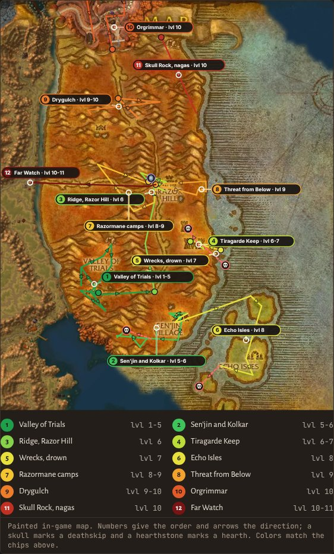

Section maps

**Valley of Trials · lvl 1-5**

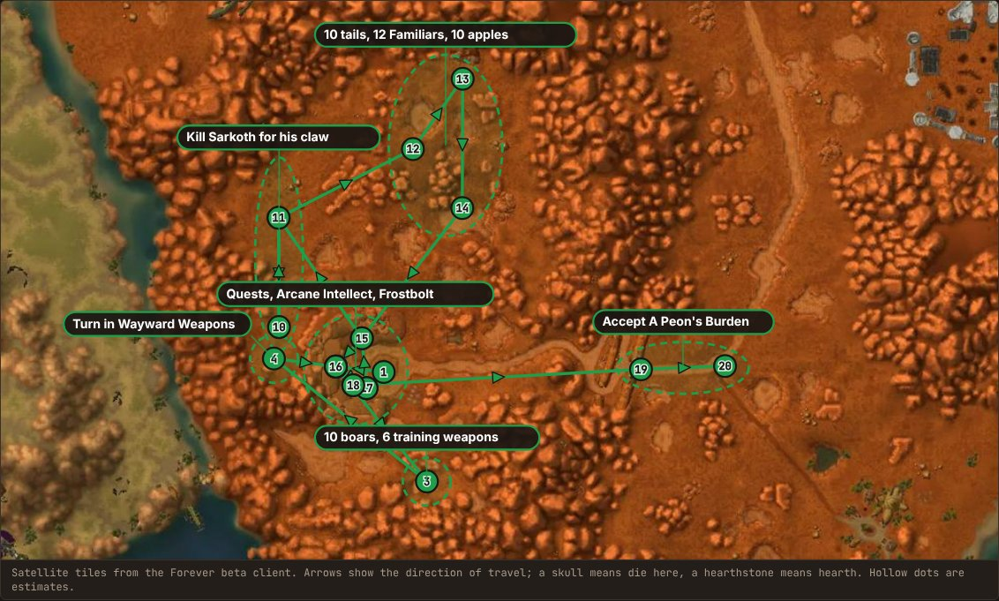

**Sen'jin and Kolkar Crag · lvl 5-6**

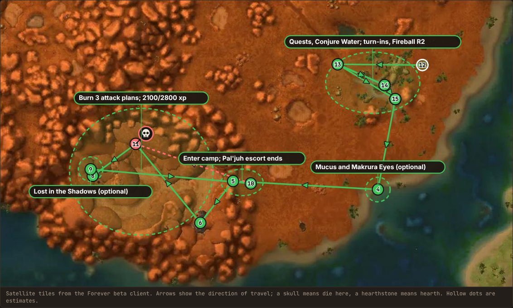

**Ridge and Razor Hill · lvl 6**

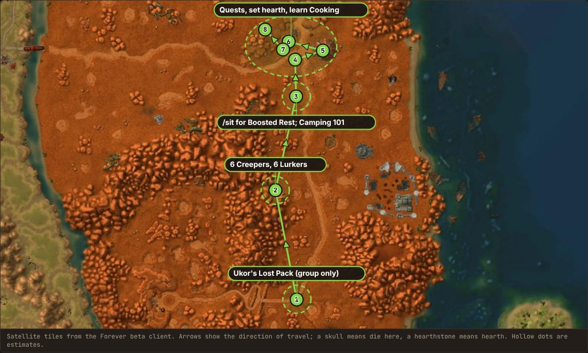

**Tiragarde Keep · lvl 6-7**

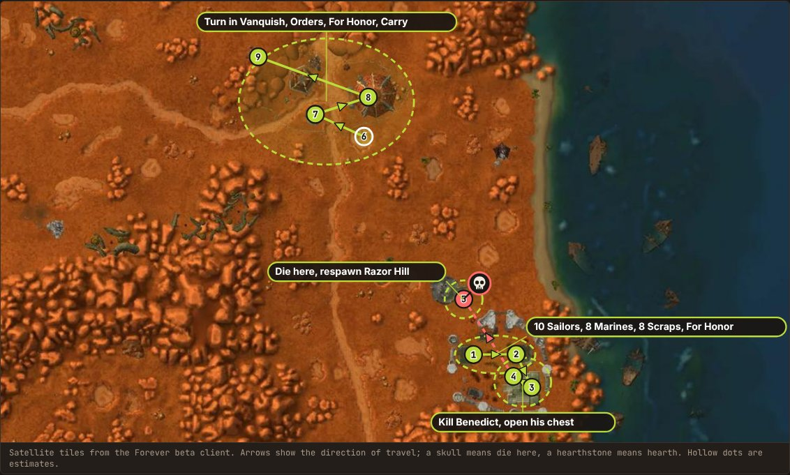

**Wreckage, Sen'jin and Echo Isles · lvl 7-8**

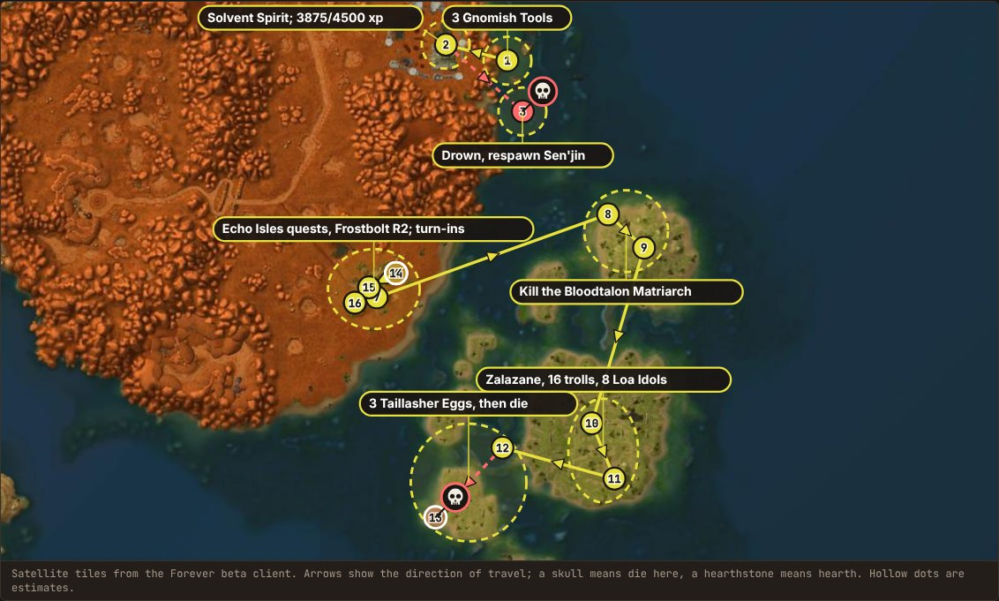

**Razor Hill and the Razormane · lvl 8-9**

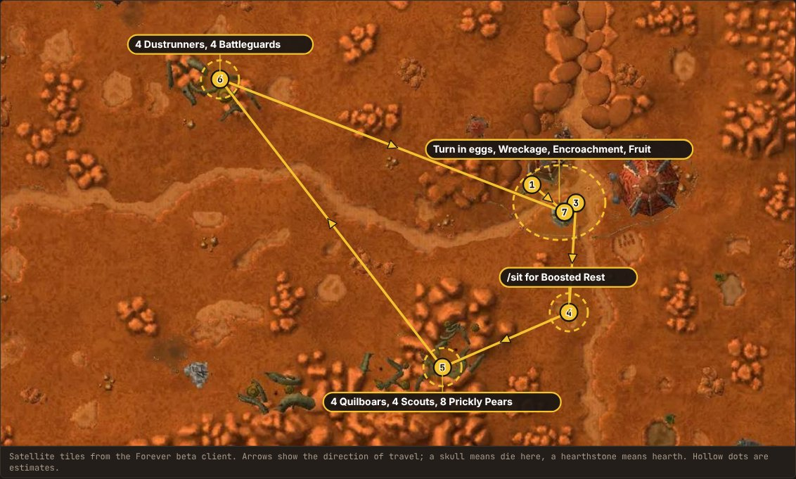

**Threat from Below · lvl 9**

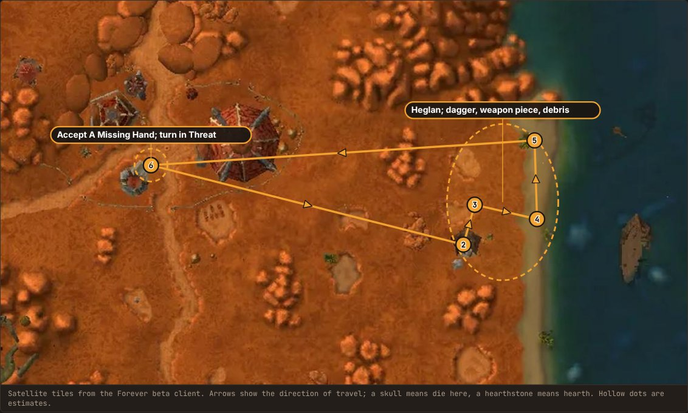

**Drygulch and Thunder Ridge · lvl 9-10**

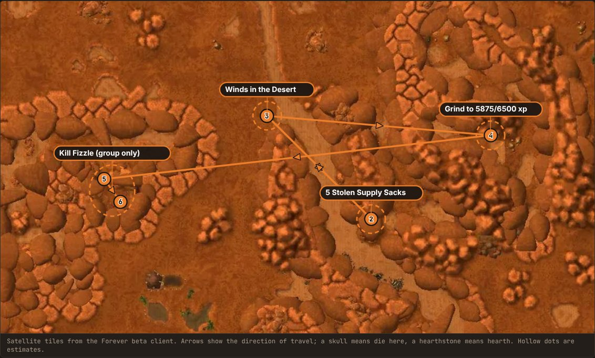

**Orgrimmar · lvl 10**

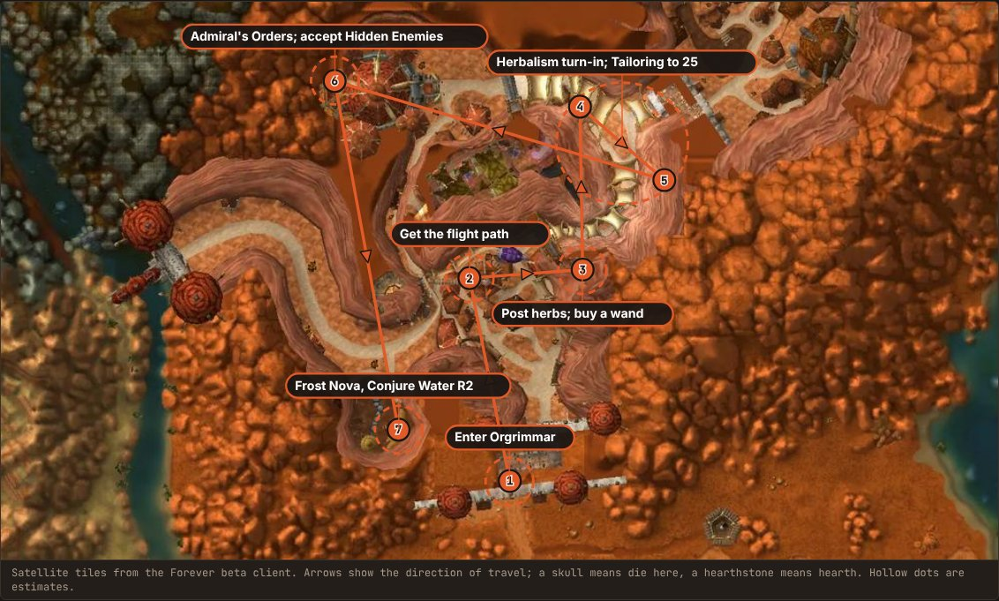

**Skull Rock and the Spitelash Coast · lvl 10**

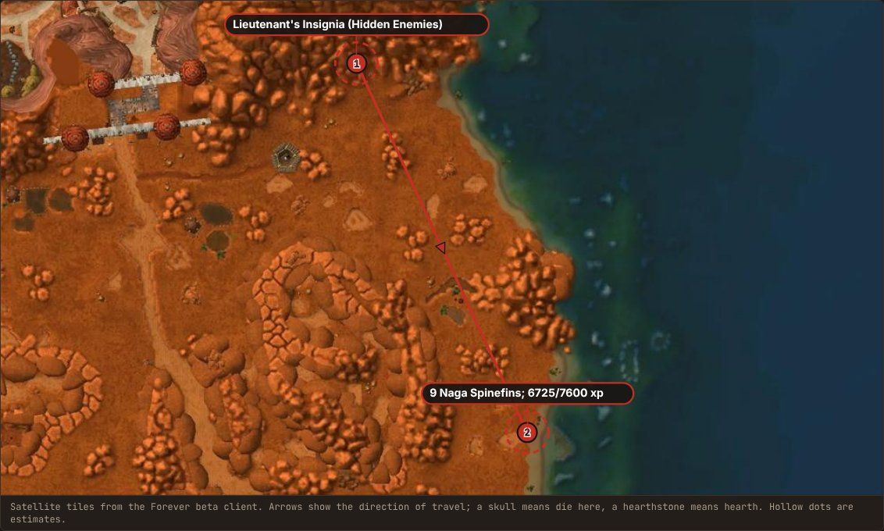

**Hearth and Far Watch · lvl 10-11**

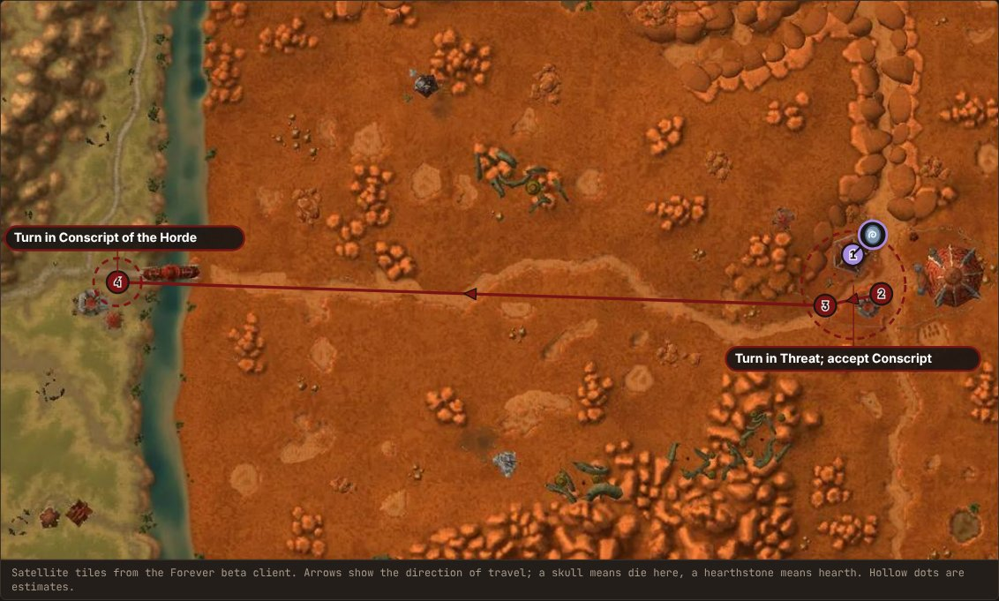

Map data: [ForeverChanges](https://foreverchanges.pro/map/kalimdor).
